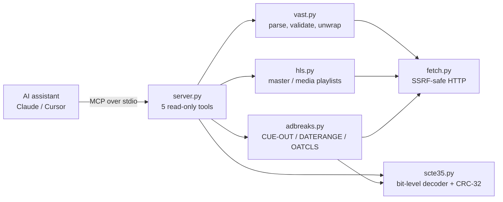

# vast-hls-mcp

[](https://github.com/PadharaHitesh/vast-hls-mcp/actions/workflows/ci.yml)


**An MCP server that lets AI assistants debug video ad delivery.** It validates VAST ad tags, follows wrapper chains, inspects HLS streams and finds and decodes SCTE-35 ad breaks.

Connect it to Claude, Cursor or any other [Model Context Protocol](https://modelcontextprotocol.io) client and ask questions like these:

> *"Why isn't this ad tag filling on Roku?"*
> *"Are the ad breaks in this live stream aligned with the SCTE-35 cues?"*
> *"What does `/DAvAAAAAAAA///wFAVIAACP...` mean?"*

The assistant calls the right tool, gets structured results back and explains what's wrong in plain English.

---

## Why

Debugging server-side ad insertion (SSAI) and CTV ad delivery means juggling ad tags, XML, manifests and binary SCTE-35 cues across several tools. An ad doesn't play, a break runs short, or impressions go missing, and it takes an hour of copy-pasting into validators to find the cause.

`vast-hls-mcp` packages that know-how as tools an AI can call. The domain logic is deterministic and fully tested. The LLM does what it's good at: it decides which tool to run next and explains the result.

## Tools

| Tool | Input | What it tells you |
|---|---|---|
| `validate_vast` | ad tag URL or VAST XML | Version, InLine or Wrapper ads, creatives, media files and tracking events, plus **errors and warnings**: missing Impression, a bad Duration, `http://` media, a missing UniversalAdId or AdServingId (VAST 4), no MP4/HLS rendition, and no-fill without an Error URL |
| `unwrap_vast` | ad tag URL | Follows the wrapper chain hop by hop (ad system, status, latency, impressions) and reports one outcome: `inline`, `no_fill`, `loop`, `too_deep`, `http_error`, `fetch_error` or `parse_error` |
| `inspect_hls` | `.m3u8` URL or text | **Master playlists:** variants, bandwidth ladder, codecs, audio and subtitle groups, I-frame playlists.<br>**Media playlists:** live or VOD, target duration, segments, discontinuities, encryption.<br>Both report RFC 8216 warnings. |
| `find_ad_breaks` | media `.m3u8` URL or text | Every ad break with its start time, **planned vs actual duration** and decoded cue. Supports `EXT-X-CUE-OUT/CUE-IN`, `EXT-X-DATERANGE SCTE35-OUT/IN` and `EXT-OATCLS-SCTE35`. Flags unmatched markers, short or long breaks, breaks that never close, and corrupted cues |
| `decode_scte35` | base64 or hex cue | Decodes `splice_insert`, `time_signal`, break duration, segmentation descriptors (type, UPID, duration), the avail descriptor and the CRC-32 check, plus a one-line summary |

## Example

The playlist in [`examples/cue_out_vod.m3u8`](examples/cue_out_vod.m3u8) has two ad breaks. The second is signalled as 30 s, but only 20 s of ad segments were stitched in.

```text
$ python scripts/smoke_test.py
tools: decode_scte35, find_ad_breaks, inspect_hls, unwrap_vast, validate_vast
decode_scte35: splice_insert, OUT (ad start), duration 60.293567s, at PTS 21514.559089s
find_ad_breaks: 2 breaks, healthy=False
  - CUE-IN at 120.294s without a matching CUE-OUT
  - break 2: planned 30.0s but segments cover 20.0s (-10.000s); viewers see filler/slate or a truncated ad
```

In an AI client the conversation looks like this:

> **You:** Check the ad breaks in `examples/cue_out_vod.m3u8`
> **Assistant:** *(calls `find_ad_breaks`)* There are 2 breaks. Break 1 is healthy: 60.29 s signalled by a SCTE-35 `splice_insert` (event 1207959695) and 60.29 s stitched. Break 2 is signalled as 30 s, but only 20 s of ad segments were stitched in, so viewers will see 10 s of slate. There's also a stray `#EXT-X-CUE-IN` at 120.3 s with no matching CUE-OUT.

## Install

Requires Python 3.11+.

```bash
git clone https://github.com/PadharaHitesh/vast-hls-mcp.git
cd vast-hls-mcp
python -m venv .venv && source .venv/bin/activate
pip install -e ".[dev]"
```

### Use with Claude Code

```bash
claude mcp add vast-hls-mcp -- /path/to/vast-hls-mcp/.venv/bin/vast-hls-mcp
```

### Use with Claude Desktop, Cursor and other MCP clients

```json
{
  "mcpServers": {
    "vast-hls-mcp": {
      "command": "/path/to/vast-hls-mcp/.venv/bin/vast-hls-mcp"
    }
  }
}
```

## Architecture



Design decisions:

- **The server never calls an LLM.** It's a deterministic toolbox. The AI client does the reasoning, so the tools are free to run, need no API key, and are easy to test.
- **SCTE-35 is decoded from scratch.** A small bit reader follows the spec's syntax tables, and a CRC-32/MPEG-2 check catches corrupted cues. There's no third-party decoder.
- **Safe by default.** Because an AI decides which URLs get fetched:
  - Only `http`/`https` is allowed.
  - Every redirect hop is re-checked.
  - Private, loopback and cloud-metadata addresses are refused (SSRF protection).
  - Responses are capped at 2 MB with a 10 s timeout.
  - XML is parsed with `defusedxml`, which blocks XXE and billion-laughs attacks.

  For local testing, set `VAST_HLS_MCP_ALLOW_PRIVATE=1`.
- **Errors are structured, not raised.** Tools return `{"ok": false, "error": ...}`, so the assistant can explain the failure instead of the call crashing.

## Development

```bash
pytest -q                       # 59 tests
ruff check . && ruff format --check .
python scripts/smoke_test.py    # end-to-end over stdio, like a real MCP client
```

The tests cover:
- the SCTE-35 sample cues from the specification, hex and base64 input, CRC failures and truncated payloads
- valid, broken, no-fill and namespaced VAST
- wrapper loops and too-deep chains
- HLS master and media playlists
- all three ad-marker styles, including a live stream joined mid-break
- SSRF and redirect protection

## Roadmap

- [ ] DASH (`EventStream` / `emsg`) SCTE-35 support
- [ ] `check_ad_pod`: validate a full SSAI pod against its VAST responses (durations, sequence)
- [ ] Segment-level checks with `ffprobe` (actual media duration vs `#EXTINF`)
- [ ] Streamable HTTP transport for remote deployments

## License

MIT © Hitesh Padhara
